# 03 — ขั้นตอนการทำงาน (Business Workflow)

> สถานะ: Phase 0 — ร่างเพื่อตรวจรับ
> แผนภาพเขียนด้วย Mermaid (GitHub แสดงผลอัตโนมัติ) รหัสกฎในวงเล็บอ้างอิง `02_BUSINESS_RULES.md`
> สมมติฐาน ASM-01: กิจการขาย **สินค้า** เป็นหลัก — ถ้าเป็นบริการ ขั้นตอน INV/RC เปลี่ยน (ดู §11 และ OI-T01)

## สารบัญ

1. ภาพรวมเส้นทางเอกสาร
2. สถานะเอกสาร (State Machine)
3. Customer Workflow
4. Product Workflow
5. Quotation Workflow
6. Delivery Workflow
7. Tax Invoice Workflow
8. Receipt Workflow
9. Payment Workflow
10. Cancellation Workflow
11. ข้อแตกต่างหากเป็นธุรกิจบริการ
12. Batch (Mode B) Workflow
13. ลำดับการทำงานภายในขณะ "ออกเอกสาร" (Sequence)

---

## 1. ภาพรวมเส้นทางเอกสาร

เส้นทางที่ระบบรองรับ (ไม่บังคับครบทุกขั้น — FR-DOC-06):

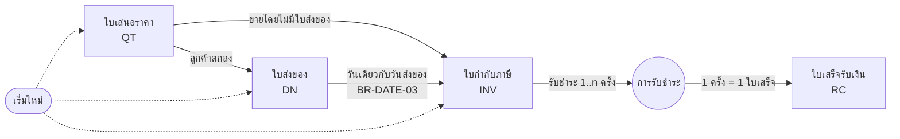

| เส้นทาง | ตัวอย่างการใช้ | หมายเหตุ |
|---|---|---|
| QT → DN → INV → RC | ขายเชื่อ มีการส่งของ | INV ลงวันที่วันส่งของ |
| QT → INV → RC | ลูกค้ารับของเอง | INV ลงวันที่วันส่งมอบ |
| INV → RC (ขายเงินสด) | ทางลัด "ขายเงินสด" (BR-PAY-10) | INV, การรับชำระ, RC เกิดในขั้นตอนเดียว |
| QT → DN (หลายใบ) → INV | ส่งของเป็นงวด | แต่ละ DN ควรมี INV วันเดียวกัน (OI-T02) |
| DN → INV | ไม่มีใบเสนอราคา | — |

## 2. สถานะเอกสาร (State Machine)

ตาม BR-ST-01 (รอตัดสินใจ D-04): วงจรชีวิตเอกสาร

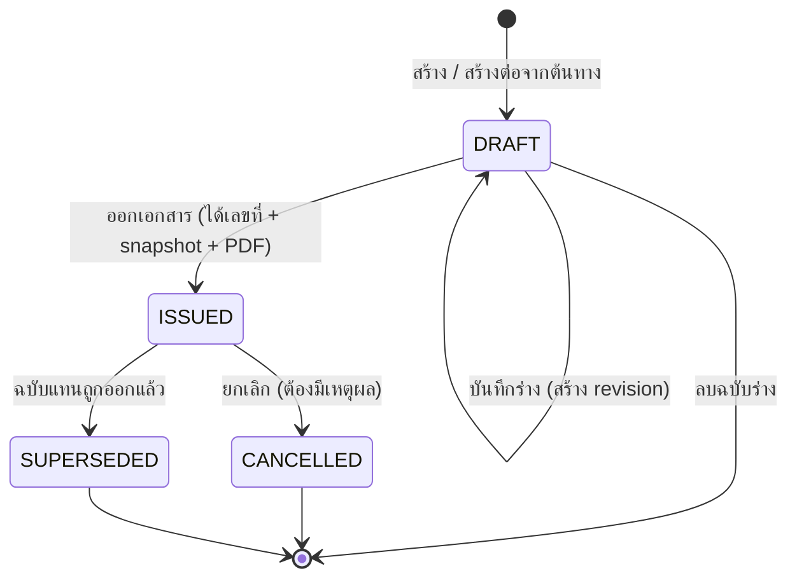

สถานะการชำระของใบกำกับภาษี (เปลี่ยนโดยระบบเท่านั้น — BR-ST-03)

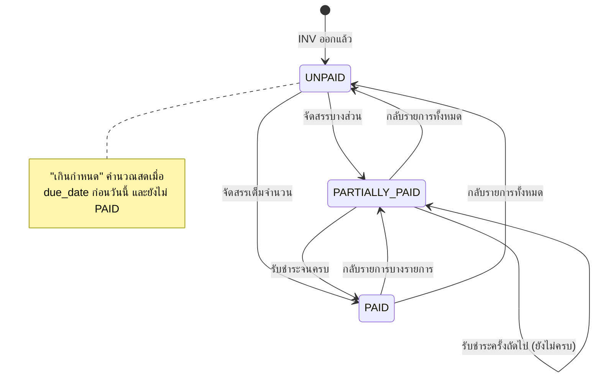

## 3. Customer Workflow

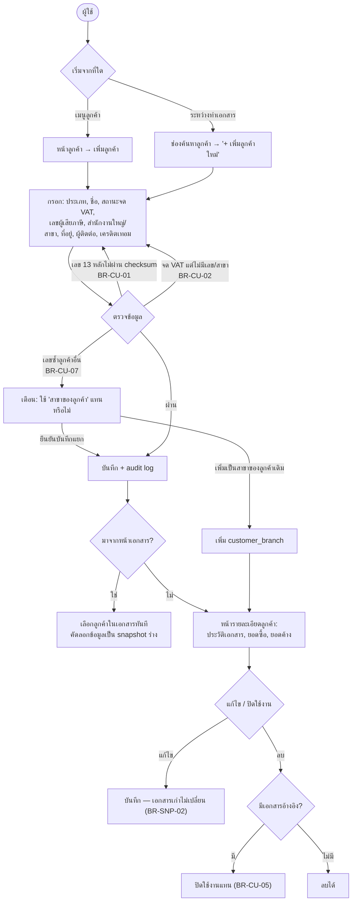

## 4. Product Workflow

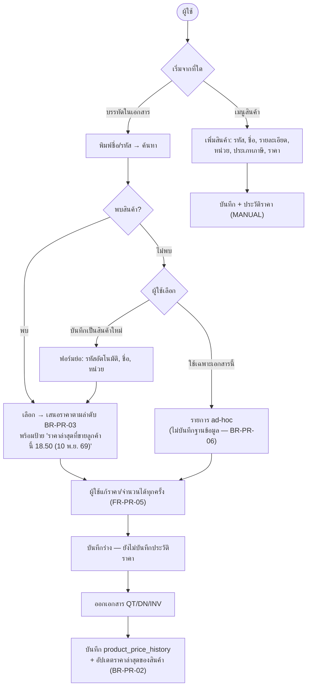

## 5. Quotation Workflow

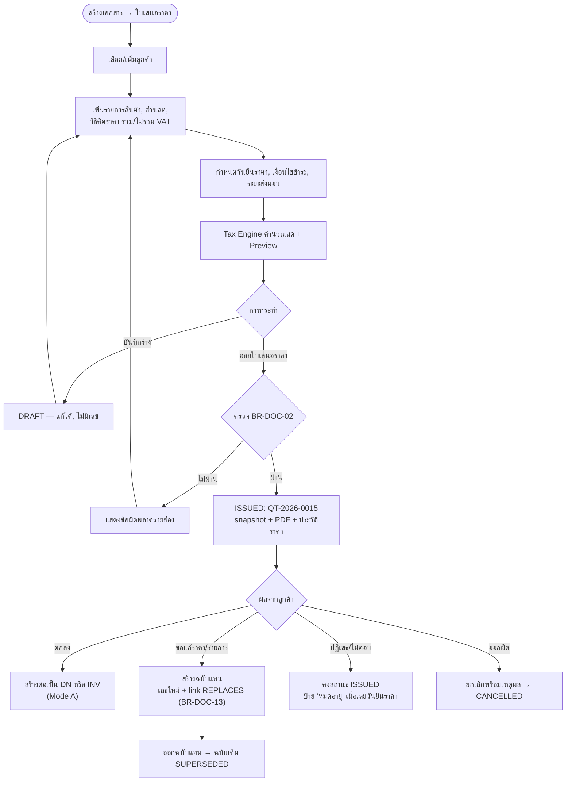

## 6. Delivery Workflow

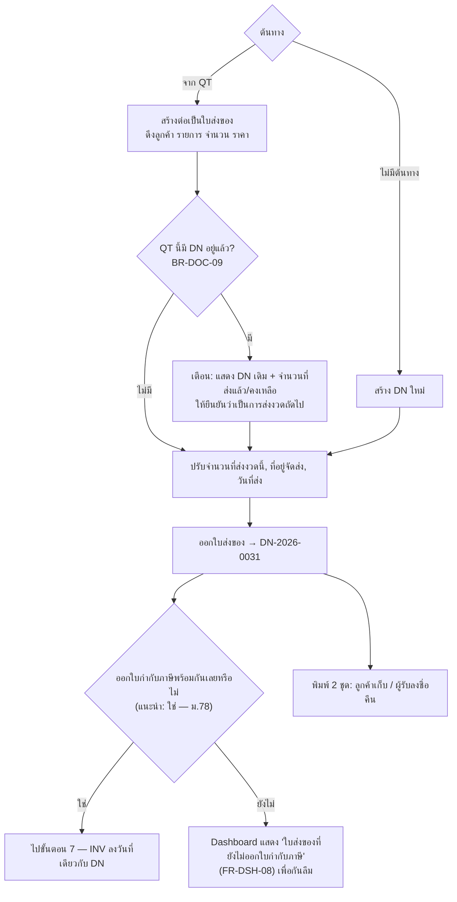

## 7. Tax Invoice Workflow

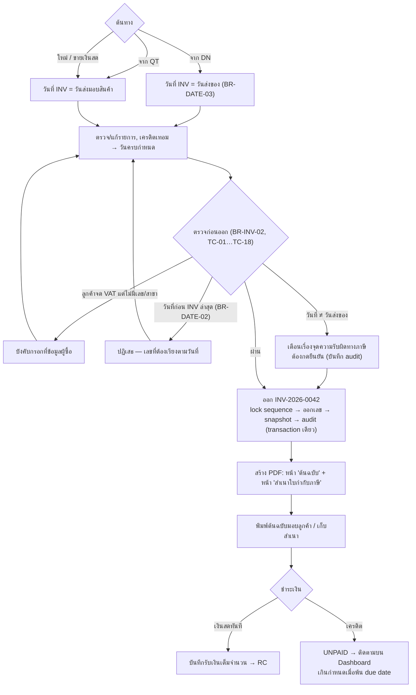

## 8. Receipt Workflow

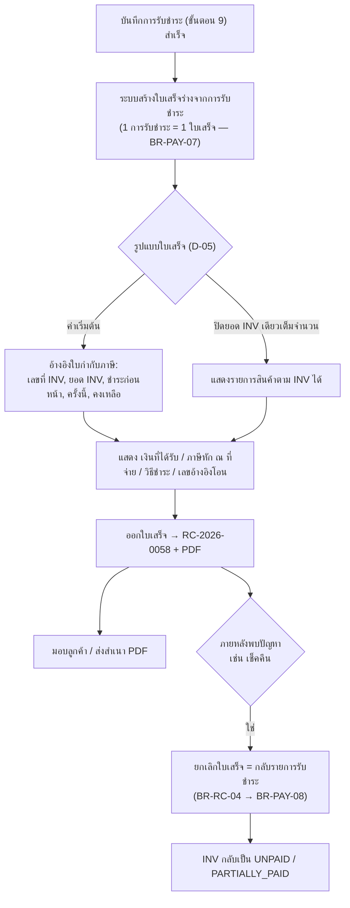

## 9. Payment Workflow

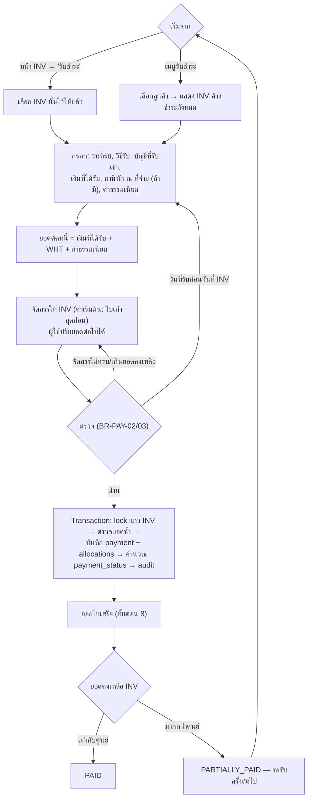

**ตัวอย่างการจัดสรร (ไม่หักซ้ำ)** — เป็นตัวอย่างอิสระ ไม่ใช่เหตุการณ์เดียวกับ RC-2026-0058 ในตัวอย่างเอกสาร (`09_DOCUMENT_TEMPLATES`): ลูกค้าโอน 20,000.00 บาท ชำระ INV-0040 (คงเหลือ 12,000.00) และ INV-0042 (คงเหลือ 15,501.73)

| การรับชำระ | INV | จัดสรร | คงเหลือหลังจัดสรร | สถานะ |
|---|---|---:|---:|---|
| PAY#1 (20,000.00) | INV-2026-0040 | 12,000.00 | 0.00 | PAID |
| PAY#1 | INV-2026-0042 | 8,000.00 | 7,501.73 | PARTIALLY_PAID |
| PAY#2 (7,501.73) | INV-2026-0042 | 7,501.73 | 0.00 | PAID |

ฐานข้อมูลปฏิเสธการจัดสรรที่ทำให้ผลรวมเกินยอด INV (BR-PAY-03) แม้จะส่งคำขอพร้อมกันสองครั้ง (BR-PAY-04)

## 10. Cancellation Workflow

```mermaid
flowchart TD
    A["ผู้ใช้กด 'ยกเลิก / ออกฉบับแทน' ที่เอกสาร ISSUED"] --> B{"ประเภทเอกสาร"}
    B -->|"QT / DN"| C{"ต้องการฉบับแทน?"}
    C -->|"ไม่"| D["ระบุรหัสเหตุผล + คำอธิบาย → CANCELLED"]
    C -->|"ใช่"| E["สร้างร่างฉบับแทน (เลขใหม่เมื่อออก)<br/>ออกแล้วฉบับเดิม → SUPERSEDED"]
    D --> D2{"มีเอกสารปลายทาง?"}
    D2 -->|"มี"| D3["เตือน: ปลายทางยังคงอยู่ (BR-DOC-12)"]
    B -->|"RC"| F["ยกเลิกใบเสร็จ = กลับรายการรับชำระ<br/>INV คำนวณสถานะใหม่"]
    B -->|"INV"| G{"มีการรับชำระที่ยัง ACTIVE?"}
    G -->|"มี และเป็นการยกเลิกเฉย ๆ"| H["ต้องกลับรายการรับชำระก่อน (BR-DOC-11)"]
    G -->|"ไม่มี"| I{"สาเหตุ"}
    G -->|"มี และเป็นการออกฉบับแทน"| J
    I -->|"รายการสาระสำคัญผิด<br/>เช่น ชื่อ/ที่อยู่/เลขผู้เสียภาษีผู้ซื้อ"| J["ป.86/2542 ข้อ 25:<br/>ฉบับใหม่ เลขที่ใหม่ วันที่เดิม<br/>หมายเหตุ 'ยกเลิกและออกแทนฉบับเลขที่ … เพราะ …'"]
    J --> K["ย้ายการจัดสรรไปฉบับใหม่ (BR-INV-08)<br/>ฉบับเดิม → SUPERSEDED"]
    K --> L["เตือนให้เรียกคืนต้นฉบับจากลูกค้า<br/>มาเก็บรวมกับสำเนา + ติ๊ก 'ได้รับคืนแล้ว'"]
    L --> M["รายงานภาษีขายเดือนที่ออกฉบับใหม่<br/>แสดงหมายเหตุการยกเลิก"]
    I -->|"ขายไม่เกิดขึ้นจริง / ออกซ้ำ"| N["CANCELLED + เหตุผล<br/>เรียกคืนต้นฉบับ — กรณีข้ามเดือนภาษีที่ยื่นแล้ว ดู OI-T12"]
    I -->|"ราคาเปลี่ยนหลังการขาย / คืนสินค้า"| O["ไม่ใช่การยกเลิก → ต้องใช้ใบลดหนี้/ใบเพิ่มหนี้<br/>(นอกขอบเขต — OI-T08, D-08)"]
    I -->|"ต้นฉบับหาย/ชำรุด"| P["ไม่ยกเลิก → ออก 'ใบแทน' (BR-INV-10)"]
```

รหัสเหตุผลการยกเลิก (ตั้งต้น — ปรับได้):

| รหัส | ความหมาย | ใช้กับ |
|---|---|---|
| WRONG_BUYER_INFO | ข้อมูลผู้ซื้อผิด | INV (ออกแทน), QT, DN |
| WRONG_ITEMS | รายการ/จำนวน/ราคาผิดตั้งแต่ออก | ทุกประเภท |
| DUPLICATE | ออกซ้ำ | ทุกประเภท |
| SALE_NOT_OCCURRED | การขายไม่เกิดขึ้น | QT, DN, INV |
| PAYMENT_FAILED | เงินไม่เข้า/เช็คคืน | RC |
| OTHER | อื่น ๆ (ต้องอธิบาย) | ทุกประเภท |

## 11. ข้อแตกต่างหากเป็นธุรกิจบริการ (รอ OI-T01)

ตามข้อความมาตรา 78/1 ที่พบในเอกสารกรมสรรพากร: ความรับผิดของการให้บริการเกิดเมื่อ **ได้รับชำระค่าบริการ** เว้นแต่ออกใบกำกับภาษีหรือใช้บริการก่อน

| ประเด็น | ขายสินค้า (สมมติฐานปัจจุบัน) | ให้บริการ |
|---|---|---|
| เวลาที่ต้องออก INV | วันส่งมอบสินค้า | วันรับเงินแต่ละครั้ง (หรือก่อนหน้า ถ้าออก INV ก่อน) |
| รับเงินหลายงวด | 1 INV เต็มจำนวน + RC หลายใบ | มักเป็น INV ต่องวดที่รับเงิน → ระบบต้องรองรับ "ใบกำกับภาษีตามยอดรับ" |
| ใบแจ้งหนี้ก่อนรับเงิน | ไม่จำเป็น | ต้องมีเอกสารเรียกเก็บที่ไม่ใช่ใบกำกับภาษี (ใบแจ้งหนี้/ใบวางบิล) — ยังไม่อยู่ในขอบเขต |
| ภาษีหัก ณ ที่จ่าย | โดยทั่วไปไม่มี | ลูกค้านิติบุคคลมักหัก 3% → FR-PAY-10 จำเป็น |

## 12. Batch (Mode B) Workflow

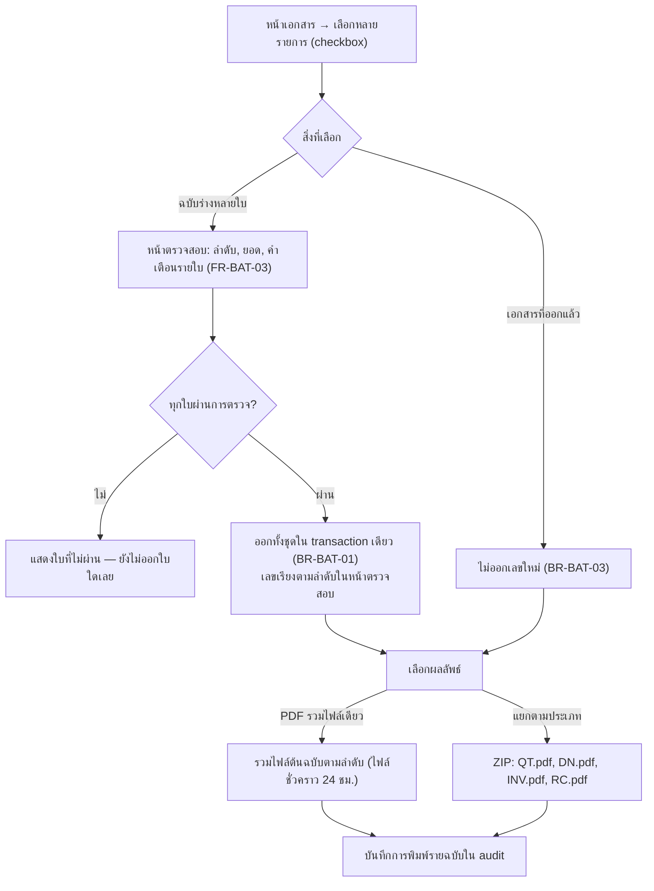

## 13. ลำดับการทำงานภายในขณะ "ออกเอกสาร"

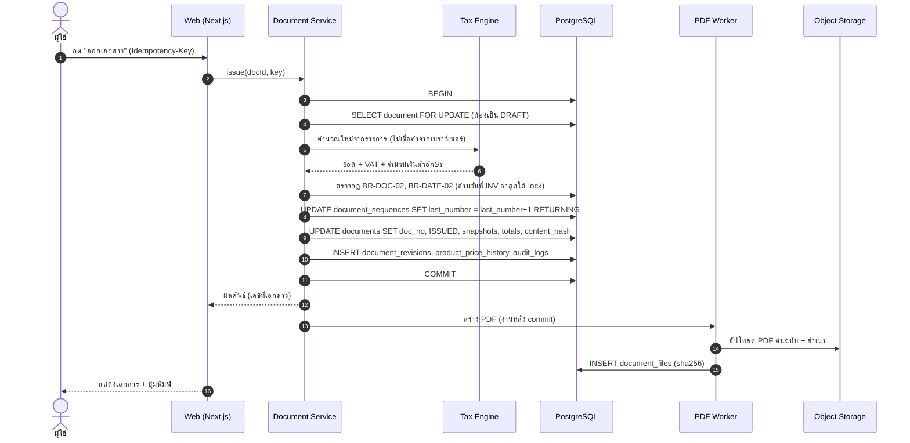

หากมีข้อผิดพลาดใด ๆ ก่อน COMMIT → ROLLBACK ทั้งหมด เลขที่ไม่ถูกใช้ (BR-NUM-03) และคำขอซ้ำด้วย Idempotency-Key เดิมจะได้ผลลัพธ์เดิม (BR-DOC-06)
