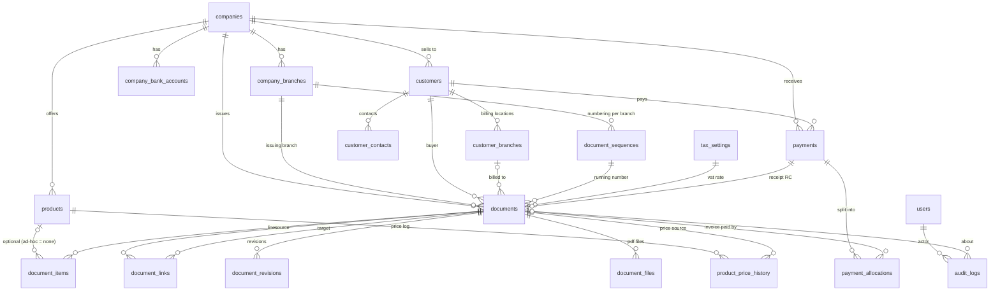
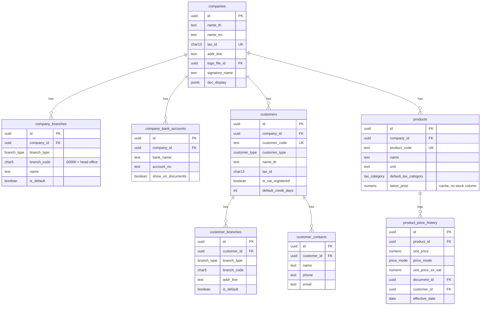
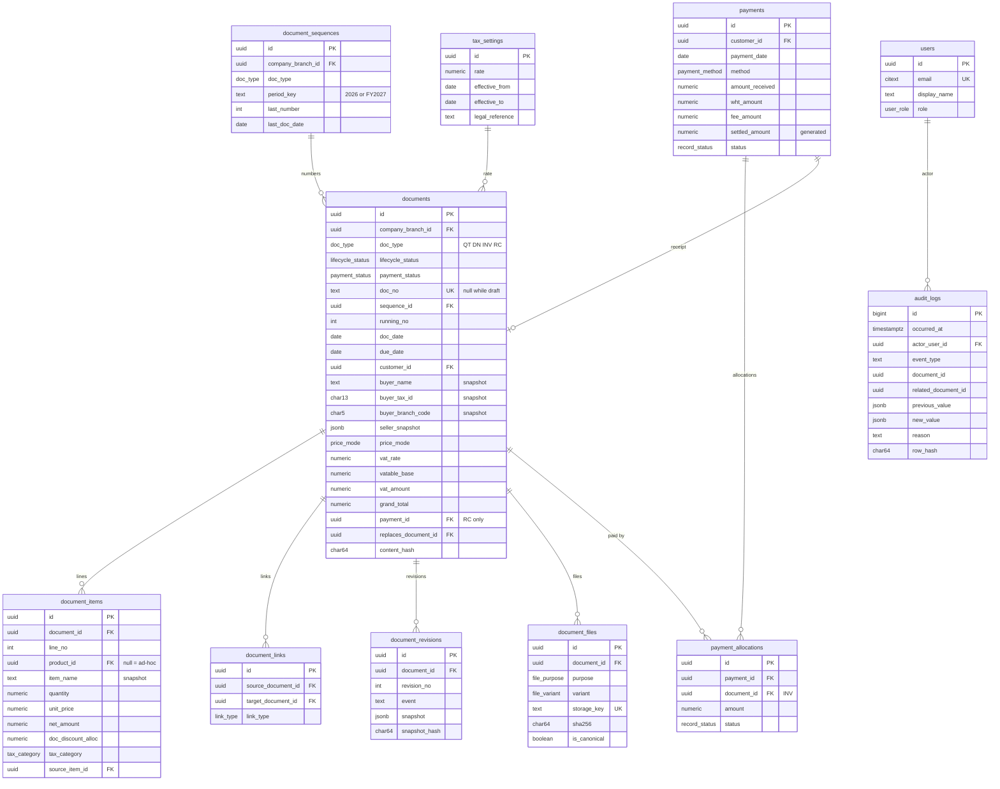

# 05 — ER Diagram

> สถานะ: Phase 0 — ร่างเพื่อตรวจรับ
> รายละเอียดคอลัมน์และ constraint ทั้งหมด: `04_DATABASE_DESIGN.md` (แผนภาพนี้แสดงเฉพาะคอลัมน์สำคัญ)
> ภาพรวมแบบรูปภาพ (ไม่ต้องใช้ Mermaid): [`05_ER_DIAGRAM_overview.svg`](05_ER_DIAGRAM_overview.svg) / [`.png`](05_ER_DIAGRAM_overview.png)

สัญลักษณ์: `||--o{` = หนึ่งต่อศูนย์หรือหลาย, `||--||` = หนึ่งต่อหนึ่ง, `|o--o{` = ศูนย์หรือหนึ่งต่อศูนย์หรือหลาย

## 1. ภาพรวมความสัมพันธ์ทั้งหมด

## 2. ข้อมูลหลัก (Master Data)

## 3. เอกสาร การรับชำระ และการตรวจสอบ

## 4. ตารางสนับสนุน (ไม่มีความสัมพันธ์บังคับ)

| ตาราง | หน้าที่ |
|---|---|
| `system_settings` | key–value ตั้งค่า |
| `idempotency_keys` | กันคำสั่งซ้ำ |
| `backup_runs` | ผลสำรอง/ทดสอบกู้คืน |

## 5. จุดที่ควรสังเกตในแผนภาพ

1. **`documents` เป็นตารางเดียวสำหรับ 4 ประเภท** — ใช้ `doc_type` แยก ทำให้สายเอกสาร, การค้นหา, audit, PDF ใช้โครงสร้างเดียวกัน คอลัมน์เฉพาะประเภท (เช่น `valid_until`, `payment_id`) ใช้ CHECK บังคับตามประเภท
2. **`document_links` เป็น n:n** — ใบเสนอราคาหนึ่งใบมีใบส่งของได้หลายใบ และใบกำกับภาษีหนึ่งใบอาจรวมหลายใบส่งของได้
3. **`payment_allocations` เป็นตัวกลางระหว่างการรับเงินกับใบกำกับภาษี** — รับเงินหนึ่งครั้งตัดได้หลายใบ ใบหนึ่งรับได้หลายครั้ง (FR-PAY-07)
4. **ใบเสร็จ (RC) ผูกกับ `payments` แบบ 1:1** — ไม่ผูกกับใบกำกับภาษีโดยตรง แต่เห็นได้ผ่าน allocations
5. **`products` ไม่มีคอลัมน์สต็อก** ตามขอบเขต (FR-PR-09)
