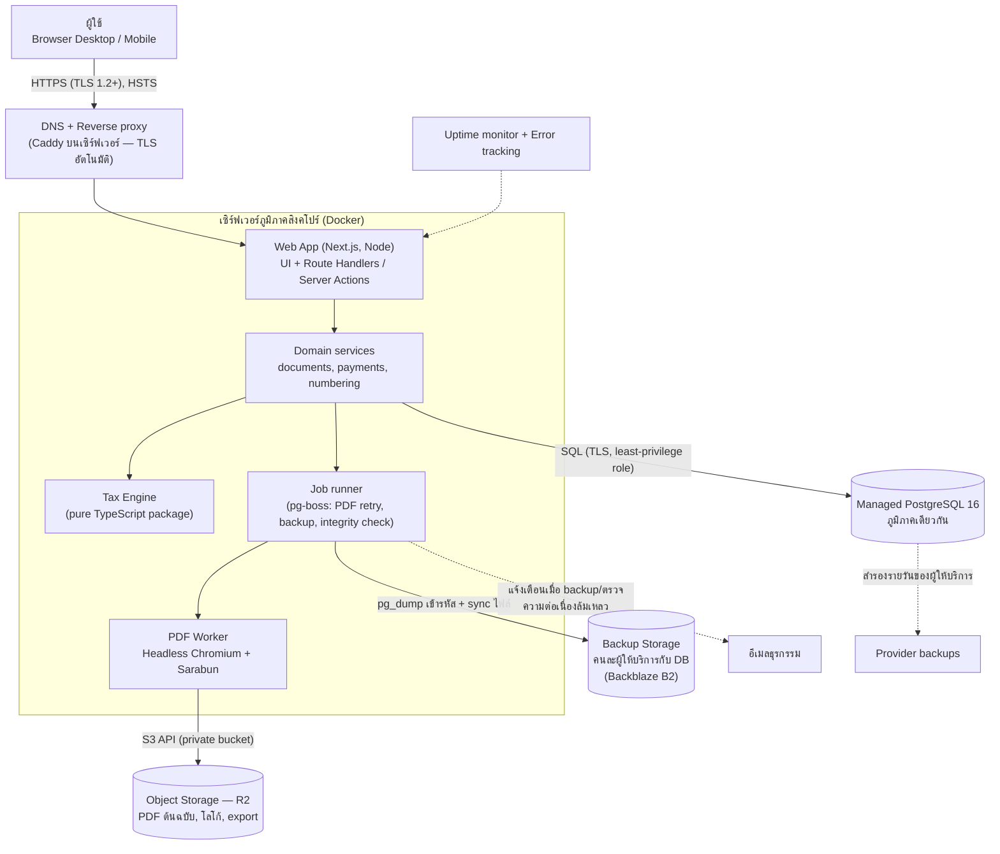

# 10 — สถาปัตยกรรมระบบ (System Architecture)

> สถานะ: Phase 0 — ข้อเสนอเพื่อตัดสินใจ (D-02) · ยังไม่ติดตั้งหรือสร้างอะไรจริง
> ราคาใน §3 มาจากบทความบุคคลที่สาม ไม่ใช่หน้าราคาทางการ (ดู `12_COST_ESTIMATION.md` §1 และ `18_LEGAL_SOURCES.md` §3) — **ต้องตรวจก่อนอนุมัติงบ**

## 1. ข้อกำหนดที่กำหนดสถาปัตยกรรม

| ข้อกำหนด | ผลต่อการเลือก |
|---|---|
| ผู้ใช้คนเดียว ไม่มีทีม IT (CON-03) | เลือกของที่ดูแลน้อย พังแล้วกู้ได้ง่าย |
| ความถูกต้องเงิน/เลขที่/ภาษีสำคัญสุด | PostgreSQL ที่รองรับ transaction, constraint, trigger, row lock เต็มรูป (`04_DATABASE_DESIGN.md`) |
| PDF ภาษาไทยต้องถูกต้อง พิมพ์ได้จริง | เครื่องมือ render ที่จัดรูปสระ/วรรณยุกต์ถูก — ทดสอบแล้วใน Phase 0 ว่า Chromium + ฟอนต์ Sarabun แสดงผลถูก (`09_DOCUMENT_TEMPLATES`) |
| กู้คืนได้จริง ต้องทดสอบ restore (PART 11) | ต้องควบคุมการสำรองและเก็บสำเนานอกผู้ให้บริการหลักได้ |
| เก็บเอกสาร ≥ 5–10 ปี | ไม่ผูกกับบริการที่ปิดหรือเปลี่ยนเงื่อนไขง่าย → ใช้มาตรฐานเปิด (PostgreSQL, S3-compatible, Docker) |
| ต้นทุนรายเดือนต่ำ (NFR-15) | ปริมาณข้อมูลน้อย (ASM-04: < 5,000 เอกสาร/ปี) |

## 2. ภาพรวมสถาปัตยกรรมที่เสนอ (Stack B)



## 3. เปรียบเทียบทางเลือก (Frontend, Backend, Database, Hosting, Storage, PDF, Backup, Security)

| ด้าน | Stack A — Serverless | **Stack B — Container + Managed DB (เสนอ)** | Stack C — VPS เดียว |
|---|---|---|---|
| Frontend | Next.js + React | Next.js + React | Next.js + React |
| Backend | Next.js serverless functions | Next.js บน Node (long-running) | Next.js บน Node |
| Database | Supabase (Postgres) | DigitalOcean Managed PostgreSQL | PostgreSQL ใน Docker บน VPS เดียวกัน |
| Hosting | Vercel Pro | VPS/Droplet สิงคโปร์ + Docker | VPS เดียว |
| File storage | Supabase Storage | Cloudflare R2 (private) | R2 หรือดิสก์ VPS |
| PDF | Chromium บน serverless — ขนาดฟังก์ชัน/เวลารันเสี่ยง [V0 — ยังไม่ได้ทดสอบ] | Chromium ใน container ถาวร | เหมือน B |
| Backup | รายวัน 7 วัน (Pro); PITR เป็นส่วนเสริมราคาสูง | สำรองรายวันของผู้ให้บริการ + pg_dump เข้ารหัสไป B2 + ทดสอบ restore | เองทั้งหมด (pg_dump/WAL → B2) |
| Auth | Supabase Auth (ผูกผู้ให้บริการ) หรือในแอป | ในแอป (Argon2id + TOTP) | ในแอป |
| ต้นทุน/เดือน (USD, ยังไม่ยืนยัน) | ≈ 45 (+100 ถ้าเปิด PITR) | ≈ 40 | ≈ 25 |

### 3.1 การให้คะแนน (1–5, มากกว่า = ดีกว่า) — เป็นดุลยพินิจของผู้วิเคราะห์ ปรับน้ำหนักได้

| เกณฑ์ | น้ำหนัก | A | B | C | หมายเหตุ |
|---|---:|---:|---:|---:|---|
| ภาระดูแลระบบน้อย | 20 | 5 | 3 | 1 | C ต้องอัปเดต OS/DB/ความปลอดภัยเอง |
| PDF ไทยเชื่อถือได้ | 15 | 2 | 5 | 5 | A เสี่ยง Chromium บน serverless |
| ควบคุมการสำรอง/กู้คืนได้จริง | 20 | 3 | 4 | 4 | B/C เก็บสำเนานอกผู้ให้บริการเองได้ |
| ต้นทุน | 10 | 3 | 4 | 5 | |
| ความปลอดภัยโดยปริยาย | 15 | 4 | 4 | 3 | C ต้อง harden เอง |
| ย้ายผู้ให้บริการได้ (ไม่ผูกติด) | 10 | 3 | 5 | 5 | |
| ความเร็วในการพัฒนา | 10 | 5 | 4 | 3 | |
| **คะแนนถ่วงน้ำหนัก (เต็ม 5)** | 100 | **3.60** | **4.05** | **3.50** | A = 360/100, B = 405/100, C = 350/100 |

**ข้อเสนอ: Stack B** — ได้คะแนนสูงสุดเพราะสมดุลระหว่างภาระดูแลและการควบคุมการกู้คืน ส่วน Stack C เป็นทางเลือกประหยัดถ้าผู้ว่าจ้างยอมรับภาระดูแลเซิร์ฟเวอร์เอง Stack A เร็วที่สุดในการเริ่มแต่ความเสี่ยง PDF และต้นทุน PITR ทำให้ไม่แนะนำสำหรับระบบที่ PDF คือเอกสารภาษี

### 3.2 เหตุผลของแต่ละเทคโนโลยี

| เลือก | เหตุผล | ทางเลือกที่ไม่เลือก และเหตุผล |
|---|---|---|
| **PostgreSQL 16** | transaction + row lock + CHECK/EXCLUDE/trigger/generated column ที่ระบบต้องพึ่ง (BR-NUM-03, BR-PAY-04, BR-DOC-05); `numeric` สำหรับเงิน; ย้ายผู้ให้บริการได้ | MySQL — EXCLUDE/partial unique index/deferred constraint trigger ที่ใช้ไม่มีเทียบเท่า; ฐานข้อมูล NoSQL — ไม่เหมาะกับข้อมูลการเงินที่ต้องการ constraint |
| **TypeScript (strict) + Next.js** | โค้ดภาษาเดียวทั้งหน้าจอและเซิร์ฟเวอร์ → **Tax Engine ชุดเดียว** ใช้ทั้งเบราว์เซอร์ (แสดงผลสด) และเซิร์ฟเวอร์ (ค่าจริง) ตาม FR-TAX-10; ระบบนิเวศใหญ่ ดูแลระยะยาวง่าย | Laravel/Django — ดี แต่ต้องเขียน Tax Engine สองภาษา (เบราว์เซอร์ + เซิร์ฟเวอร์) หรือยอมเรียก API ทุกครั้งที่แก้ตัวเลข |
| **Decimal library** (decimal.js/big.js) + `numeric` | ห้าม floating point กับเงิน (BR-GEN-03) | ใช้ `number` — ผิดกติกาและเกิดคลาดเคลื่อน |
| **Headless Chromium → PDF** | HTML/CSS แม่แบบเดียวกับ Preview; ชี้ได้ว่าสระ/วรรณยุกต์แสดงถูก (ตรวจใน Phase 0 ด้วยภาพ); พิมพ์ A4 ตรงขนาด | pdfmake/react-pdf — ต้องทดสอบการจัดรูปสระและตัดคำไทยเพิ่ม (ผลค้นหาไม่พบเปรียบเทียบตรง); wkhtmltopdf — เลิกพัฒนา |
| **Cloudflare R2** (S3 API) | ค่า egress ฟรี, ราคาต่ำ, S3-compatible ย้ายได้ | S3 — แพงกว่าสำหรับกรณีนี้; ดิสก์เซิร์ฟเวอร์ — เสี่ยงสูญหาย |
| **Backblaze B2** สำหรับสำเนาสำรอง | คนละผู้ให้บริการกับ DB/Storage หลัก (กันบัญชีหลักถูกระงับหรือถูกลบ) ราคาต่อ TB ต่ำ | เก็บสำรองที่เดียวกับของจริง — ผิดหลัก 3-2-1 |
| **pg-boss** (คิวบน PostgreSQL) | ไม่ต้องมี Redis เพิ่ม; ใช้ transaction เดียวกับข้อมูล | Redis/BullMQ — ส่วนประกอบเพิ่มโดยไม่จำเป็นที่ปริมาณนี้ |
| **Auth ในแอป** (Argon2id, TOTP, session ฝั่งเซิร์ฟเวอร์) | ผู้ใช้คนเดียว ควบคุมเองได้ ไม่ผูกผู้ให้บริการ | Auth-as-a-service — ผูกติดและต้นทุนเพิ่มโดยไม่จำเป็น |
| **Migration แบบ SQL ตรง** (+ ORM แบบเบา เช่น Drizzle/Kysely สำหรับ type) | trigger/constraint/EXCLUDE ต้องเขียน SQL เอง และตรวจได้ใน code review | ORM ที่ซ่อน SQL — ปกปิดกฎสำคัญ |

ข้อสรุปเหล่านี้ขึ้นกับ D-02; รายละเอียดเครื่องมือ (ORM, UI kit, library ทดสอบ) เป็น ADR ที่ตัดสินใน Phase 1

## 4. โครงสร้างโค้ดที่เสนอ (เพื่อให้ดูแลระยะยาวได้ — ยังไม่สร้างใน Phase 0)

```
bizflow/
├─ packages/
│  ├─ tax-engine/        # pure functions: calc, rounding, baht-text, tin-check  (ไม่มี I/O, coverage 100% branch)
│  ├─ domain/            # กฎ BR-*: สถานะ, ลิงก์เอกสาร, ใบเสร็จ, การจัดสรร (ไม่รู้จัก HTTP)
│  ├─ db/                # migrations (SQL), queries, seed, integrity checks
│  └─ templates/         # HTML/CSS แม่แบบเอกสาร (ใช้ทั้ง Preview และ PDF) + golden files
├─ apps/
│  └─ web/               # Next.js: หน้าจอ, route handlers, auth, jobs
├─ docs/                 # (ย้ายจาก Documentation/BizFlow) + ADR
└─ ops/                  # docker-compose, Caddyfile, backup scripts, restore runbook, CI
```

หลักการ: `tax-engine` ไม่ import อะไรเลย → ทดสอบง่าย ใช้ซ้ำได้ · `domain` ไม่รู้จักฐานข้อมูลโดยตรง (รับ interface) · กฎที่ห้ามพลาดมีทั้งในโค้ดและในฐานข้อมูล (defense in depth)

## 5. ส่วนประกอบและหน้าที่

| ส่วนประกอบ | หน้าที่ | หมายเหตุ |
|---|---|---|
| Web App | หน้าจอ 13 หน้า (`08_WIREFRAMES`), API ภายใน, auth, session | ไม่มี API สาธารณะ |
| Domain services | ออกเอกสาร, ออกเลขที่, รับชำระ/จัดสรร, ยกเลิก/ออกแทน — ทุกคำสั่งเป็น transaction เดียวพร้อม audit | ลำดับตาม `03_WORKFLOW.md` §13 |
| Tax Engine | คำนวณ 7 ขั้น, ปัดเศษ, จำนวนเงินตัวอักษร, ตรวจเลขผู้เสียภาษี | เวอร์ชันบันทึกในเอกสาร (`calc_engine_version`) |
| PDF Worker | render แม่แบบ → PDF → อัปโหลด + บันทึก sha256 | ลองใหม่อัตโนมัติ; ไม่บล็อกการออกเอกสาร (BR-DOC-04) |
| Job runner | PDF retry, สำรองข้อมูล, ตรวจความต่อเนื่องเลขที่/hash (`04` §10), ล้างไฟล์ชั่วคราว, เตือนอัตรา VAT ใกล้หมด | pg-boss; งานตั้งเวลาด้วย cron ของคิว |
| PostgreSQL | แหล่งความจริงเดียว | role แยก: `app_rw` (ไม่มีสิทธิ์ DDL), `migrator`, `readonly_reports`, `backup_ro` |
| Object storage | PDF ต้นฉบับ/สำเนา, โลโก้, export ชั่วคราว | bucket private; ดาวน์โหลดผ่าน signed URL อายุ ≤ 5 นาที ที่ออกหลังตรวจ session |
| Backup storage | สำเนาฐานข้อมูลเข้ารหัส + สำเนา object | บัญชี/คีย์คนละชุดกับระบบหลัก |

## 6. การไหลของข้อมูลสำคัญ

| การทำงาน | เส้นทาง | จุดควบคุม |
|---|---|---|
| คำนวณตัวเลขขณะแก้เอกสาร | เบราว์เซอร์เรียก `tax-engine` ในเครื่อง (ไม่ต้องรอเซิร์ฟเวอร์) | เซิร์ฟเวอร์คำนวณซ้ำทุกครั้งที่บันทึก/ออก — ไม่ตรงปฏิเสธ (TR-11) |
| ออกเอกสาร | ตามแผนภาพลำดับ `03_WORKFLOW.md` §13 | idempotency key, row lock ลำดับเลข, trigger กันแก้ภายหลัง |
| สร้าง PDF | job หลัง commit → Chromium (โหลดแม่แบบ + ข้อมูลจาก snapshot ไม่ใช่ข้อมูลหลักปัจจุบัน) → R2 | sha256, `template_version`, golden test |
| ดาวน์โหลด/พิมพ์ | ตรวจ session → audit → signed URL | BR-PRT-02 (ต้นฉบับซ้ำต้องมีเหตุผล) |
| สำรองข้อมูล | ทุกคืน: `pg_dump` (custom format) → เข้ารหัส → B2; sync object ใหม่ → B2; บันทึก `backup_runs` | แจ้งเตือนถ้าไม่สำเร็จ/ขนาดผิดปกติ |

## 7. สภาพแวดล้อมและการส่งมอบ

| สภาพแวดล้อม | ใช้ทำอะไร | ข้อมูล |
|---|---|---|
| Local | พัฒนา (docker-compose: Postgres จริง) | ข้อมูลสมมติเท่านั้น |
| CI | ทดสอบทุก commit: unit, integration กับ **PostgreSQL จริง** (ทดสอบ trigger/constraint/ concurrency), E2E (Playwright), lint, type-check, secret scan | ฐานข้อมูลชั่วคราว |
| Staging (ไม่บังคับ) | ซ้อม migration และ restore drill ก่อน production | สำเนาข้อมูลที่ปิดบังแล้ว |
| Production | ใช้งานจริง | ข้อมูลจริง — ห้ามใช้ข้อมูลจริงในสภาพแวดล้อมอื่น |

การ deploy: CI ผ่าน → สร้าง image → migration (ต้องผ่านการตรวจ + backup ก่อนทุกครั้ง) → สลับเวอร์ชัน → health check → ย้อนกลับได้ (เก็บ image 5 เวอร์ชัน) · Migration ที่ทำลายข้อมูลต้องแยกเป็นสองขั้น (expand/contract)

## 8. การเฝ้าระวัง

| ด้าน | วิธี |
|---|---|
| ความพร้อมใช้ | `/healthz` (ตรวจ DB + storage + Chromium) + uptime monitor จากภายนอก |
| ข้อผิดพลาด | error tracking (เลือกผู้ให้บริการแบบฟรีใน Phase 1; ห้ามส่งข้อมูลลูกค้า/เลขผู้เสียภาษีเข้าบริการนี้ — ตัดช่องข้อมูลก่อนส่ง) |
| งานเบื้องหลัง | แจ้งเตือนเมื่อ backup/PDF/integrity check ล้มเหลว |
| ทรัพยากร | ดิสก์, หน่วยความจำ (Chromium), จำนวน connection DB |
| ต้นทุน | budget alert รายเดือนที่ผู้ให้บริการ |

## 9. ข้อจำกัดของสถาปัตยกรรมนี้ (พูดตรง ๆ)

1. **จุดล้มเหลวเดียว:** เซิร์ฟเวอร์เดียว ไม่มี high availability — ถ้าล่ม ต้องกู้ภายใน RTO 4 ชม. จากสำรอง (เหมาะกับผู้ใช้คนเดียว; ถ้าต้องการ HA ต้นทุนเพิ่มประมาณเท่าตัว)
2. **ภาระดูแล:** Stack B ยังต้องอัปเดต OS/image/dependency เป็นระยะ (กำหนดรอบรายเดือนใน `11` §9)
3. **ราคาและความสามารถของผู้ให้บริการยังไม่ยืนยันจากหน้าทางการ** (CON-06 และข้อจำกัดเครือข่าย Phase 0)
4. **Chromium ใช้หน่วยความจำมาก:** เซิร์ฟเวอร์ต้อง ≥ 2 GB (ต้นทุน §12) — ใช้ pool 1 เพจต่อครั้งเพื่อคุมการใช้ทรัพยากร
5. ยังไม่ได้ทดสอบการตัดบรรทัดภาษาไทยกับรายการยาวมาก (RISK-06)

## 10. ADR เริ่มต้น (ตัดสินใจแล้วในเอกสาร ยกเว้นที่ระบุ)

| ADR | เรื่อง | สถานะ |
|---|---|---|
| ADR-001 | PostgreSQL + `numeric` + Decimal ในโค้ด | เสนอ (ไม่ขึ้นกับ D-02) |
| ADR-002 | ออกเลขที่ด้วย row lock บน `document_sequences` (ไม่ใช้ SEQUENCE) | เสนอ — เหตุผล: ไม่มีเลขขาดช่วงเมื่อ rollback (BR-NUM-03) |
| ADR-003 | Tax Engine เป็น pure package ใช้ร่วมเบราว์เซอร์/เซิร์ฟเวอร์ | เสนอ |
| ADR-004 | PDF ด้วย Chromium + ฟอนต์ฝัง; แม่แบบ HTML เดียว | เสนอ — ยืนยันบางส่วนด้วยตัวอย่าง Phase 0 |
| ADR-005 | Defense in depth: กฎสำคัญบังคับทั้งโค้ดและฐานข้อมูล | เสนอ |
| ADR-006 | Stack B (D-02) | **รอผู้ว่าจ้างอนุมัติ** |
| ADR-007 | Auth ในแอป + TOTP บังคับ (D-10) | รอ D-10 |
