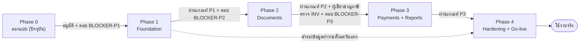

# 13 — แผนพัฒนา Phase 1–4 (Development Roadmap)

> สถานะ: Phase 0 — ข้อเสนอเพื่ออนุมัติ · **ห้ามเริ่ม Phase 1 จนกว่าผู้ว่าจ้างอนุมัติ Phase 0 อย่างชัดเจน** (STOP CONDITION)
> เกณฑ์ตรวจรับรายละเอียดทุกข้อ: `14_ACCEPTANCE_CRITERIA.md` (รหัส AC-Pn-xx) · ประเด็นที่ต้องปิดก่อนเริ่มแต่ละ Phase: `15_OPEN_ISSUES.md` (ป้าย BLOCKER-Pn)

## 1. ภาพรวมและระยะเวลาโดยประมาณ

สมมติฐานการประมาณ: นักพัฒนา 1 คนทำงานเต็มเวลาร่วมกับผู้ช่วย AI, ผู้ว่าจ้างตอบคำถามภายใน 2 วันทำการ, ผู้เชี่ยวชาญภาษีตรวจตามจุดที่กำหนด · ความคลาดเคลื่อนของการประมาณ ±40% (ยังไม่เคยวัดความเร็วทีมนี้) · **ไม่รวมเวลารอคำตอบ Open Issues**

| Phase | ชื่อ | เป้าหมาย | สัปดาห์ (ต่ำ–สูง) | ผลที่ผู้ว่าจ้างจับต้องได้เมื่อจบ |
|---|---|---|---|---|
| 1 | Foundation & Master Data | โครงระบบ, ความปลอดภัย, ฐานข้อมูลหลัก, Tax Engine, ตัวสำรองข้อมูล | 4–5 | เข้าสู่ระบบ (MFA) จัดการกิจการ/ลูกค้า/สินค้า/ตั้งค่า; Tax Engine ผ่านทุก test vector; สำรองข้อมูลทำงานและกู้คืนทดสอบได้ |
| 2 | Documents | QT/DN/INV ครบวงจร, เลขที่, Snapshot, PDF, ลิงก์เอกสาร, ยกเลิก/ออกแทน | 6–7 | ออกใบเสนอราคา ใบส่งของ ใบกำกับภาษีจริง (ในสภาพแวดล้อมทดสอบ) พิมพ์ PDF ต้นฉบับ/สำเนา ตรวจโดยผู้เชี่ยวชาญภาษี |
| 3 | Payments, Receipts, Reports | รับชำระ/จัดสรร, ใบเสร็จ, Dashboard, รายงาน 9 ชุด, ออก/พิมพ์หลายฉบับ | 5–6 | วงจรขาย→รับเงิน→ใบเสร็จครบ; รายงานตรงกับเอกสาร; export Excel/CSV/PDF |
| 4 | Hardening & Go-live | ความปลอดภัย, ประสิทธิภาพ, ซ้อมกู้คืนใหญ่, UAT, นำเข้าข้อมูล, ส่งมอบ | 3–4 | ผ่าน UAT และ Checklist ภาษี; ซ้อมกู้คืนผ่าน; พร้อมใช้งานจริง |
| **รวม** | | | **18–22** | ≈ 4–5 เดือนปฏิทินถ้าไม่มีการรอ (18 สัปดาห์ ≈ 4.1 เดือน, 22 สัปดาห์ ≈ 5.1 เดือน); แนะนำวางแผน 6–7 เดือนรวมการรอคำตอบและการตรวจภาษี |

หากอนุมัติ D-08 (ใบลดหนี้/ใบเพิ่มหนี้) เป็น Phase 3 เพิ่มอีก ≈ 2–3 สัปดาห์

## 2. ลำดับและความสัมพันธ์ระหว่าง Phase

| ลำดับ | เหตุผลของลำดับ |
|---|---|
| Tax Engine และ Audit/Numbering ก่อนหน้าจอเอกสาร | ทุกเอกสารพึ่งพา; ผิดแล้วแก้ย้อนหลังแพง |
| สำรองข้อมูลและซ้อมกู้คืนเริ่มใน Phase 1 | ข้อมูลทดสอบชุดแรกก็ควรอยู่ภายใต้แผนเดียวกัน; พิสูจน์ล่วงหน้าว่ากู้ได้ |
| ใบกำกับภาษี (INV) ก่อนใบเสร็จ (RC) | RC อ้างอิง payment และ INV |
| รายงานหลังรับชำระ | รายงานลูกหนี้/รับชำระต้องมีข้อมูลการจัดสรร |
| Hardening ท้ายสุด แต่ **ไม่ใช่การเริ่มคิดเรื่องความปลอดภัย** | ความปลอดภัยพื้นฐาน (auth, validation, trigger) ทำตั้งแต่ Phase 1 |

## 3. Phase 1 — Foundation & Master Data (4–5 สัปดาห์)

**ต้องปิดก่อนเริ่ม:** D-01, D-02, D-03, D-04, OI-T07, OI-T13, (OI-T16 ถ้าใช้ภาษีผสม) · **ต้องมี:** การอนุมัติ Phase 0 เป็นลายลักษณ์อักษร

| WP | งาน | อ้างอิงข้อกำหนด | ผลงาน |
|---|---|---|---|
| 1.1 | Repo (private), CI/CD, docker-compose, สภาพแวดล้อม local/CI/prod, secret scan, pre-commit | NFR-12, `11` §4 | pipeline เขียว, deploy ได้ |
| 1.2 | ฐานข้อมูลฐาน: migrations ของ T01–T09, T13, T17–T22 + constraint/trigger + ทดสอบกับ PostgreSQL จริง | `04` | schema + test suite |
| 1.3 | Auth: Argon2id, TOTP, session, rate limit, รีเซ็ตรหัสผ่าน, อีเมลธุรกรรม | FR-AUTH-*, `11` §2 | หน้า S-01 ใช้งานจริง |
| 1.4 | **Tax Engine** (pure package): 7 ขั้น, ปัดเศษ, ยอดตัวอักษร, ตรวจเลขผู้เสียภาษี; test vectors TV-01…09 + property tests 10,000 ชุด | FR-TAX-*, `06` §5–6 | coverage 100% branch |
| 1.5 | Settings: กิจการ, สาขา, บัญชีธนาคาร, โลโก้, รูปแบบเลขที่, อัตราภาษี, ค่าเริ่มต้น | FR-CO-*, FR-SET-* | หน้า S-13 |
| 1.6 | ลูกค้า (สาขา/ผู้ติดต่อ/ค้นหา) และสินค้า (ประวัติราคา, ค้นหา, นำเข้า CSV) | FR-CU-*, FR-PR-* | หน้า S-10, S-11 |
| 1.7 | Audit log + hash chain + trigger ห้ามแก้ ห้ามลบ; Idempotency | FR-AUD-*, `04` T19, T21 | ทดสอบพยายามแก้แล้วถูกปฏิเสธ |
| 1.8 | **สำรองข้อมูลอัตโนมัติ + ทดสอบกู้คืนรายสัปดาห์ + คู่มือกู้คืน v1 + แจ้งเตือน** | FR-BAK-*, `11` §6–8 | `backup_runs` มีผลสำเร็จ; ซ้อมกู้คืนครั้งแรกผ่าน |
| 1.9 | Observability พื้นฐาน: health check, error tracking (ตัดข้อมูลส่วนบุคคล), uptime | NFR-17 | alert ทดสอบถึงอีเมล |

**ลำดับภายใน:** 1.1 → 1.2 → (1.3 ∥ 1.4 ∥ 1.7) → 1.5 → 1.6 → 1.8 → 1.9 (1.8 เริ่มพร้อม 1.2 ได้ แต่ปิดงานหลังมีข้อมูลทดสอบ)
**ความเสี่ยง:** RISK-03 (ตัวเลข), RISK-05 (บัญชี), RISK-04 (สำรอง) · **การทดสอบ:** unit (engine), integration กับ PostgreSQL จริง (constraint/trigger), E2E login/CRUD, restore test อัตโนมัติ · **เกณฑ์:** AC-P1-01…AC-P1-14

## 4. Phase 2 — Documents (6–7 สัปดาห์)

**ต้องปิดก่อนเริ่ม:** OI-T01, OI-T02, OI-T03, OI-T04, OI-T06, OI-T10 (ถ้าทำแม่แบบ RC ล่วงหน้า), OI-T12, D-18, D-20, D-21 · **ต้องมี:** Phase 1 ผ่านเกณฑ์

| WP | งาน | อ้างอิง | ผลงาน |
|---|---|---|---|
| 2.1 | Schema เอกสาร: T10–T12, T14, T18 + trigger ห้ามแก้เอกสารที่ออกแล้ว + ทดสอบ | `04` T10–T18 | test suite |
| 2.2 | บริการออกเลขที่ + ทดสอบพร้อมกัน 50 คำขอ + ข้ามปี/ข้ามเที่ยงคืน Asia/Bangkok | FR-NUM-*, BR-NUM-* | ไม่มีเลขซ้ำ/ขาด |
| 2.3 | ตัวแก้เอกสาร S-04 (QT/DN/INV): ค้นหาลูกค้า/สินค้า, ราคาล่าสุด, ส่วนลด, ราคารวม/ไม่รวม VAT, preview, autosave | FR-DOC-*, FR-PR-*, FR-QT-*, FR-DN-*, FR-INV-* | หน้า S-03, S-04 |
| 2.4 | ธุรกรรมออกเอกสาร: snapshot, content_hash, price history, idempotency | BR-DOC-03, BR-SNP-* | ออกแล้วแก้ไม่ได้ (ทดสอบตรง DB) |
| 2.5 | PDF: แม่แบบ QT/DN/INV (ต้นฉบับ+สำเนา), worker, retry, sha256, golden-file tests, ข้อความไทยยาว | FR-PDF-*, `09` | PDF ตรงตัวอย่าง Phase 0 |
| 2.6 | สร้างต่อจากต้นทาง (Mode A), กันสร้างซ้ำ, คำเตือนวันที่ (ม.78), สายเอกสาร | FR-DOC-03…06, BR-DOC-07…09, BR-DATE-03 | |
| 2.7 | ยกเลิก / ออกฉบับแทน (INV ตามข้อ 25), ใบแทน (ม.86/12), SUPERSEDED, วันปิดงวดภาษี | BR-INV-07…10, BR-DATE-07 | |
| 2.8 | รายการ/รายละเอียด/ประวัติเอกสาร S-05…S-07, ค้นหา, พิมพ์ย้อนหลัง | FR-DOC-11, 12 | |
| 2.9 | **จุดตรวจ:** ผู้เชี่ยวชาญภาษีตรวจ INV ตัวอย่างจากระบบจริงเทียบ TC-01…TC-18 | CL-03 | ใบรับรองผลตรวจ |

**ความเสี่ยง:** RISK-01, 02, 06, 10, 12 · **การทดสอบ:** integration (concurrency 50 ชุด), golden PDF, E2E ออก→ยกเลิก→ออกแทน, ทดสอบเอกสารข้ามปี · **เกณฑ์:** AC-P2-01…AC-P2-18

## 5. Phase 3 — Payments, Receipts, Reports (5–6 สัปดาห์)

**ต้องปิดก่อนเริ่ม:** OI-T08 และ D-08 (ขอบเขตใบลดหนี้), OI-T09/D-16, OI-T10, OI-T11/D-09, OI-T17, D-05, D-14 · **ต้องมี:** Phase 2 ผ่านเกณฑ์ + CL-03

| WP | งาน | อ้างอิง | ผลงาน |
|---|---|---|---|
| 3.1 | Schema รับชำระ: T15–T16 + constraint trigger ตอน commit + ทดสอบพร้อมกัน | BR-PAY-02…05 | ตัดหนี้ซ้ำไม่ได้ |
| 3.2 | หน้ารับชำระ S-08: จัดสรรหลายใบ, WHT, ค่าธรรมเนียม, ทางลัดรับเต็มจำนวน/ขายเงินสด | FR-PAY-* | |
| 3.3 | ใบเสร็จ RC: แม่แบบ 2 รูปแบบ, 1 payment = 1 RC | FR-RC-*, BR-RC-* | |
| 3.4 | กลับรายการรับชำระ (เช็คคืน) + ยกเลิกใบเสร็จ | BR-PAY-08/09, BR-RC-04 | |
| 3.5 | Dashboard S-02 (ทุกตัวเลขมีเกณฑ์กำกับ) | FR-DSH-* | |
| 3.6 | รายงาน 9 ชุด + export Excel/CSV(UTF-8 BOM)/PDF | FR-RPT-* | หน้า S-12 |
| 3.7 | ออก/พิมพ์หลายเอกสาร (Mode B) | FR-BAT-*, BR-BAT-* | หน้า S-09 |
| 3.8 | (ถ้า D-08 อนุมัติ) ใบลดหนี้/ใบเพิ่มหนี้ — ประมาณการแยก ≈ 2–3 สัปดาห์ | OI-T08 | |
| 3.9 | ตรวจเทียบรายงานกับเอกสาร (reconciliation test) | BR-RPT-* | ยอดตรง 100% |

**ความเสี่ยง:** RISK-02, 03, 07 · **การทดสอบ:** concurrency รับชำระพร้อมกัน, reconciliation (ผลรวมรายงาน = ผลรวมเอกสาร), E2E วงจรเต็ม · **เกณฑ์:** AC-P3-01…AC-P3-16

## 6. Phase 4 — Hardening & Go-live (3–4 สัปดาห์)

**ต้องปิดก่อนเริ่ม:** OI-L01, ยืนยัน D-14 (ข้อมูลนำเข้า) · **ต้องมี:** Phase 3 ผ่านเกณฑ์

| WP | งาน | ผลงาน |
|---|---|---|
| 4.1 | ทดสอบความปลอดภัย: ASVS L1 checklist, ZAP baseline, payload SQLi/XSS/HTML-in-PDF/IDOR, สแกน secret ทั้งประวัติ git | รายงาน + แก้ครบ |
| 4.2 | ทดสอบประสิทธิภาพ: ข้อมูลจำลอง 50,000 เอกสาร (NFR-05) | รายงานเวลาตอบสนอง |
| 4.3 | **ซ้อมกู้คืนใหญ่** (`11` §8.2) โดยผู้ทำตามเอกสาร; ปรับคู่มือจนผ่าน | บันทึกผล RTO จริง |
| 4.4 | ตรวจการเข้าถึง (axe + คีย์บอร์ด) และทดสอบมือถือจริง | รายงาน |
| 4.5 | UAT โดยผู้ว่าจ้าง + Checklist ภาษี CL-01…CL-08 กับผู้เชี่ยวชาญภาษี | ใบรับรองผล |
| 4.6 | นำเข้าข้อมูลจริง (ลูกค้า/สินค้า — และยอดค้างถ้า D-14), แผน cutover, คู่มือผู้ใช้ภาษาไทย | ข้อมูลพร้อม |
| 4.7 | ส่งมอบ: คู่มือกู้คืน, ADR, ทะเบียนบัญชี/คีย์, ตารางบำรุงรักษา (`11` §9), ฟังก์ชันส่งออกข้อมูลทั้งหมด (FR-EXP-01) | เอกสารส่งมอบ |

**ความเสี่ยง:** RISK-01, 04, 05, 11 · **เกณฑ์:** AC-P4-01…AC-P4-14

## 7. กลยุทธ์การทดสอบรวม

| ชั้น | เครื่องมือ/วิธี | ครอบคลุม |
|---|---|---|
| Unit | Vitest (หรือเทียบเท่า) | Tax Engine, กฎ BR ที่เป็นฟังก์ชันบริสุทธิ์ |
| Property-based | fast-check (หรือเทียบเท่า) | Tax Engine 10,000 ชุด; ความสอดคล้องผลรวม |
| Integration (**PostgreSQL จริง**) | Testcontainers/CI service | constraint, trigger, row lock, immutability, audit hash chain |
| Concurrency | สคริปต์ยิงพร้อมกัน 50 คำขอ | เลขที่เอกสาร, การจัดสรรชำระ |
| Golden-file | เทียบ PDF/PNG กับไฟล์อ้างอิง | แม่แบบ, ข้อความไทยยาว |
| E2E | Playwright (Chromium + WebKit; viewport 1440×900 และ 390×844) | ขั้นตอนตาม `03_WORKFLOW.md` |
| Security | ZAP baseline + payload ชุดทดสอบ + secret scan | `11` §10 |
| Accessibility | axe + ทดสอบคีย์บอร์ด | NFR-14 |
| Restore | งานอัตโนมัติรายสัปดาห์ + ซ้อมใหญ่รายไตรมาส | `11` §8 |
| UAT | สถานการณ์จริงโดยผู้ว่าจ้าง | ทั้งระบบ |

กฎ: CI ต้องเขียวก่อน merge/deploy · ฟีเจอร์ที่แตะเงิน/เลขที่/ภาษีต้องมี test ก่อนถือว่าเสร็จ · "mutation check" กับ Tax Engine เพื่อยืนยันว่า test จับข้อผิดได้จริง

## 8. ประตูตรวจรับ (Phase Gates)

1. จบแต่ละ Phase: สาธิตกับผู้ว่าจ้าง + รายงานเทียบ `14_ACCEPTANCE_CRITERIA.md` (ผ่าน/ไม่ผ่านพร้อมหลักฐาน — ห้ามรายงานว่าเสร็จถ้าไม่มีหลักฐาน)
2. **ไม่เริ่ม Phase ถัดไปจนกว่าผู้ว่าจ้างอนุมัติอย่างชัดเจน**
3. การเปลี่ยนขอบเขต/ข้อกำหนดต้องได้รับอนุมัติเป็นลายลักษณ์อักษรก่อน (Change control — RISK-07)
4. ประเด็นที่ยังมี BLOCKER ของ Phase นั้นค้างอยู่ ห้ามเริ่ม Phase

## 9. ข้อสมมติและข้อจำกัดของแผนนี้

- ระยะเวลาเป็นการประมาณเชิงตรรกะ ไม่ได้อิงข้อมูลความเร็วจริงของทีม
- ถ้าผู้เชี่ยวชาญภาษีเสนอให้เปลี่ยนกฎสำคัญ (เช่น OI-T06, OI-T12, OI-T13) หลัง Phase 2 เริ่ม อาจต้องแก้ Tax Engine/แม่แบบ/ฐานข้อมูล — เหตุผลที่ต้องปิด BLOCKER ก่อนเริ่ม
- แผนนี้สมมติ Stack B (D-02); ถ้าเลือก Stack A เพิ่มงานทดสอบ PDF บน serverless ≈ 1 สัปดาห์; Stack C เพิ่มงานเตรียมเซิร์ฟเวอร์และความปลอดภัยโฮสต์ ≈ 1–2 สัปดาห์
