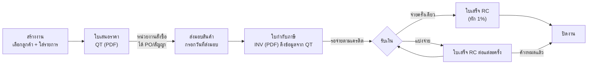

# 19 — BizFlow Lite: ขอบเขตรุ่นแรกที่ใช้งานจริง (ข้อเสนอ)

> สถานะ: **ข้อเสนอเพื่อให้ผู้ว่าจ้างอนุมัติ** (Phase 0 — ยังไม่มีโค้ด ยังไม่เริ่ม Phase 1) · เกิดจากคำตอบของผู้ว่าจ้างเมื่อ 26 พ.ย. 2569
> เอกสารนี้ **ไม่ได้ลบ** แผนเต็มใน `01`–`18` — เป็น "ชุดย่อยที่ทำก่อน" ที่ต่อยอดไปแผนเต็มได้ภายหลัง (รอ D-24)
> ภาพหน้าจอมือถือ: `19_LITE_WIREFRAMES/png/` · ตัวอย่างใบเสร็จหน่วยงานรัฐ: `09_DOCUMENT_TEMPLATES/pdf/RC-2026-0059_gov.pdf`

## 1. คำตอบของผู้ว่าจ้าง → ผลต่อการออกแบบ

| ความต้องการ/คำตอบ | ผลต่อรุ่นแรก |
|---|---|
| ต้อง "ทำง่าย ๆ" เพราะต้องนั่งทำเอกสารใหม่บ่อย ๆ | **กรอกครั้งเดียว** แล้วดึงข้อมูลลูกค้า/รายการ/ราคาไปใช้ในเอกสารถัดไปเอง (ใบเสนอราคา → ใบกำกับภาษี → ใบเสร็จ) |
| ทำงานที่บ้านเป็นหลัก อยากใช้บนมือถือ | ออกแบบ **มือถือก่อน** (จอ 390 px) ใช้ได้บนคอมด้วยหน้าเว็บเดียวกัน — เว็บแอปที่ "เพิ่มลงหน้าจอหลัก" ได้ ไม่ต้องลงแอป |
| ส่งเป็น PDF แล้วพิมพ์ได้ทุกที่ | สร้าง **PDF A4 มาตรฐาน** แชร์ผ่าน LINE/อีเมล/Drive ได้จากเมนูแชร์ของมือถือ พิมพ์ผ่านมือถือ ร้านปริ้นต์ หรือเครื่องที่ใช้ได้ |
| เก็บข้อมูลและบิลย้อนหลังได้ | ค้นหาย้อนหลังด้วยชื่อลูกค้า/เลขที่/เลข PO; เปิด PDF ต้นฉบับเดิมซ้ำได้โดยไม่เปลี่ยนข้อมูล |
| เอกสารเป็นชุด: ใบเสนอราคา + ใบกำกับภาษี + ใบเสร็จ | 3 ประเภทนี้เท่านั้น **ไม่มีใบส่งของ** (ตามที่ตอบ) |
| ขาย **หน่วยงานรัฐ เป็นเงินเชื่อ มีหักภาษี ณ ที่จ่าย 1%** | หัวใจของรุ่นนี้: บันทึกการรับเงินพร้อมภาษีหัก 1% และออกใบเสร็จที่แสดงบรรทัดหักภาษีให้ถูก (§5) |
| ลูกค้ามีเครดิต จ่ายทีหลัง หรือแบ่งจ่ายบ่อย | **รับเงินหลายครั้งต่อใบกำกับภาษี** แสดงยอดคงเหลือ และออกใบเสร็จทุกครั้งที่รับเงิน |
| รุ่นแรกใช้งานจริงก่อน แล้วค่อยเพิ่ม | ตัดสิ่งที่ยังไม่จำเป็นออก (§4) แต่วางโครงข้อมูลให้เพิ่มได้ภายหลังโดยไม่รื้อ |

## 2. แนวคิด: "งาน" หนึ่งงาน = เอกสารที่เกี่ยวข้องทั้งชุด

ผู้ใช้ไม่ต้องเลือกประเภทเอกสารก่อน — เริ่มจาก **"สร้างงาน"** แล้วเลือกลูกค้า (หน่วยงาน) ใส่รายการ ระบบพาไปตามลำดับ ผู้ใช้เห็น "งานของฉัน" เป็นการ์ดต่อหนึ่งงาน (ภาพ `L1_jobs.png`):

| หลักการ | รายละเอียด |
|---|---|
| ข้ามขั้นได้ | ไม่ต้องมีใบเสนอราคาก็ได้ (เริ่มที่ใบกำกับภาษีเลย) — ตรงกับ FR-DOC-06 |
| ข้อมูลไหลต่อเอง | ใบกำกับภาษีดึงลูกค้า รายการ จำนวน ราคา ส่วนลด จาก QT มาแล้ว แก้ได้ก่อนออก (ภาพ `L3`) |
| ใบเสร็จตามจริง | **ใบเสร็จออกได้เฉพาะเมื่อมีการรับเงินแล้ว** (1 การรับเงิน = 1 ใบเสร็จ) — ขายเงินเชื่อจึงออกพร้อมใบกำกับภาษีวันเดียวกันไม่ได้ ยกเว้น "ขายเงินสด" ที่มีทางลัดออกครบในครั้งเดียว |
| "ชุดงาน" ไม่ใช่ตารางใหม่ | จัดกลุ่มจาก `document_links` ที่มีอยู่แล้ว (ไม่เพิ่มตาราง) — เลข PO/สัญญา เก็บในเอกสารเป็นเลขอ้างอิง |
| พิมพ์/แชร์ทั้งชุด | ปุ่มเดียวรวม QT + INV + RC ของงานนั้นเป็น PDF ไฟล์เดียว หรือ ZIP แยกไฟล์ (ใช้ไฟล์ต้นฉบับที่ออกไปแล้ว ไม่สร้างเลขใหม่) |
| ชื่อบนหน้าจอ | ใช้คำว่า **"งาน"** ไม่ใช้ "เอกสารออกเป็นชุด" เพราะเป็นศัพท์เฉพาะตามคำสั่งกรมสรรพากร ป.86/2542 ข้อ 6 (ดู C-07, OI-T03 และ D-25) |

## 3. หน้าจอรุ่นแรก (มือถือก่อน)

| # | หน้าจอ | ภาพ | อ้างอิงแบบเต็ม |
|---|---|---|---|
| 1 | งานของฉัน (ค้นหา/กรอง/ยอดค้าง) | `L1_jobs.png` | S-02, S-05 |
| 2 | รายละเอียดงาน (สายเอกสาร, ยอดคาดว่าจะได้รับหลังหักภาษี) | `L2_job_detail.png` | S-06 |
| 3 | สร้าง/แก้ใบเสนอราคา | ใช้โครงเดียวกับ `S04` (ฉบับมือถือ `S04_document_editor_mobile.png`) | S-04 |
| 4 | ออกใบกำกับภาษีจากใบเสนอราคา | `L3_invoice_from_qt.png` | S-04 |
| 5 | รับเงิน + หัก ณ ที่จ่าย 1% | `L4_payment_wht.png` | S-08 |
| 6 | ใบเสร็จ + ส่ง/พิมพ์ | `L5_share_print.png` | S-06, S-09 (ย่อ) |
| 7 | ลูกค้า (รายการ/เพิ่ม/แก้) | ใช้ตามแบบ `S10` | S-10 |
| 8 | รายงาน 3 ชุด | ใช้ตามแบบ `S12` | S-12 |
| 9 | ตั้งค่า (ข้อมูลบริษัท, เลขที่เอกสาร, บัญชีธนาคาร) | ใช้ตามแบบ `S13` | S-13 |
| 10 | เข้าสู่ระบบ | `S01_login` | S-01 |

## 4. ขอบเขต: ทำก่อน / เลื่อน / ตัด

| กลุ่ม | รุ่นแรก (ทำ) | เลื่อนไปรุ่นถัดไป | ตัดออกจากแผน |
|---|---|---|---|
| เอกสาร | ใบเสนอราคา, ใบกำกับภาษีเต็มรูป, ใบเสร็จ; เลขที่อัตโนมัติไม่ซ้ำ/ไม่ขาด; Snapshot; ยกเลิก/ออกแทน (ป.86/2542 ข้อ 25); PDF ต้นฉบับ+สำเนา | ใบส่งของ (ตามที่ผู้ว่าจ้างตอบ — ออกแบบไว้แล้ว เพิ่มได้); ใบแทน (ม.86/12) ถ้ายังไม่จำเป็น; ใบลดหนี้/เพิ่มหนี้ (D-08 — ดูความเสี่ยง RISK-16) | — |
| การรับเงิน | รับหลายครั้ง, ยอดคงเหลือ, ภาษีหัก ณ ที่จ่าย, เลขที่หนังสือรับรอง, ใบเสร็จต่อการรับเงิน, กลับรายการเมื่อเช็คคืน/บันทึกผิด | จัดสรรเงินก้อนเดียวไปหลายใบกำกับภาษีบนหน้าจอ (โครงข้อมูลมีแล้ว) | — |
| ข้อมูลหลัก | บริษัท (สำนักงานใหญ่ 1 แห่ง), ลูกค้า, รายการสินค้า/บริการที่ใช้บ่อย + **จำราคาล่าสุดต่อลูกค้า** | หลายสาขา (ของบริษัทและของลูกค้า), ผู้ติดต่อหลายคน, หน้าประวัติราคา/กราฟ, นำเข้า CSV | — |
| ค้นหาและเก็บย้อนหลัง | ค้นด้วยชื่อ/เลขที่/PO/ช่วงวันที่, เปิดไฟล์ต้นฉบับเดิม, ส่งออกข้อมูลทั้งหมด | — | — |
| รายงาน | 3 ชุด: ลูกหนี้ค้างชำระ, รับชำระรายเดือน (แยกเงินที่ได้รับ/ภาษีหัก), ภาษีขายรายเดือน — export Excel/CSV | อีก 6 ชุด, Dashboard เต็ม (ใช้หน้า "งานของฉัน" แทน) | — |
| พิมพ์/ส่ง | PDF รายฉบับ + รวมชุด; แชร์ผ่านเมนูมือถือ | ส่งอีเมลจากระบบ | e-Tax Invoice (D-12) ไม่อยู่ในแผน |
| ความปลอดภัยและสำรอง | เข้าสู่ระบบ+MFA, สำรองข้อมูลอัตโนมัติ, ทดสอบกู้คืน, audit log | — | — |
| ผู้ใช้ | ผู้ใช้คนเดียว | หลายผู้ใช้/สิทธิ์ | — |

**สิ่งที่ตัดไม่ได้แม้เป็นรุ่นง่าย** (เพราะเป็นหลักฐานภาษีและความถูกต้องของเงิน): เลขที่ไม่ซ้ำไม่ขาดช่วง · เอกสารที่ออกแล้วแก้ไม่ได้ · Snapshot ข้อมูล ณ วันออก · Audit log · สำรองข้อมูลพร้อมทดสอบกู้คืนจริง · คำนวณภาษีด้วย Tax Engine กลาง

**ข้อจำกัดที่ต้องรู้:** ต้องมีอินเทอร์เน็ตจึงใช้งานได้ (ไม่มีโหมดออฟไลน์ในรุ่นแรก) · "พิมพ์ได้ทุกที่" หมายถึงได้ไฟล์ PDF มาตรฐาน A4 ที่เครื่องพิมพ์/ร้านปริ้นต์ทั่วไปเปิดได้ — การสั่งพิมพ์ไร้สายจากมือถือขึ้นกับรุ่นเครื่องพิมพ์ ไม่ใช่สิ่งที่ระบบควบคุมได้

## 5. ภาษีหัก ณ ที่จ่าย 1% (ลูกค้าหน่วยงานรัฐ)

### 5.1 สิ่งที่ทราบและที่ยังไม่ทราบ

| ประเด็น | ข้อมูล | ระดับ |
|---|---|---|
| หน่วยงานรัฐหักภาษี ณ ที่จ่ายร้อยละ 1 เมื่อจ่ายให้บริษัท/ห้างหุ้นส่วนนิติบุคคล (อ้างมาตรา 69 ทวิ) | พบในผลค้นหาจาก rd.go.th (เช่น หนังสือหารือ [0702/3841](https://www.rd.go.th/65193.html)) | V1 |
| เกณฑ์ตั้งแต่ 10,000 บาทขึ้นไป | พบ แต่ไม่ชัดว่านับ **ต่อใบสั่งซื้อ/ต่อครั้ง หรือรวมยอดต่อผู้รับ** | V1 บางส่วน |
| ฐานคิด 1% — **ก่อน VAT หรือรวม VAT** | **ไม่พบแหล่งยืนยัน** (ระบบเสนอ "ก่อน VAT" เป็นค่าเริ่มต้นแก้ได้) | **V0** |
| ผู้ขายต้องออกใบเสร็จเต็มยอดหรือยอดสุทธิ / แสดงภาษีหักอย่างไร | ไม่พบ | V0 |
| ภาระของผู้ขาย (บริษัทของคุณ) ต่อภาษีที่ถูกหัก: ขอรับหนังสือรับรอง (50 ทวิ) เป็นเครดิตภาษีเมื่อยื่นภาษีเงินได้นิติบุคคล | ไม่ได้ศึกษา — เป็นเรื่องของผู้ทำบัญชี | V0 |

→ **ผู้เชี่ยวชาญภาษีต้องยืนยันก่อนใช้จริง** (OI-T20) ระบบจึงออกแบบให้ทุกค่าเป็น "ข้อเสนอที่แก้ได้" และบันทึกว่าใช้ค่าเริ่มต้นหรือแก้เอง

### 5.2 การออกแบบ

| ข้อ | การทำงาน |
|---|---|
| ช่องหัก ณ ที่จ่าย | อยู่ที่ **การรับเงิน** ไม่ใช่ที่ใบกำกับภาษี (ใบกำกับภาษีไม่เปลี่ยน) |
| ตั้งต่อลูกค้า | ลูกค้าแต่ละรายตั้ง "ถูกหักภาษีหรือไม่ / อัตรา (ค่าเริ่มต้น 1%)" — หน่วยงานรัฐเปิดไว้ |
| ค่าที่เสนอ | ภาษีหัก = 1% × (ยอดตัดหนี้ครั้งนี้ × สัดส่วนมูลค่าก่อน VAT ต่อยอดรวมของใบกำกับภาษี) ปัดครึ่งขึ้น 2 ตำแหน่ง |
| แบ่งจ่าย | ภาษีหักของ **งวดสุดท้ายปรับให้ผลรวมทุกงวด = 1% ของมูลค่าก่อน VAT ทั้งใบ** (กันเศษสตางค์สะสม) แก้ตัวเลขได้ทุกงวด |
| ใบเสร็จ | แสดงแยกบรรทัด: ยอดตัดหนี้ / ภาษีหัก ณ ที่จ่าย / ค่าธรรมเนียม / **เงินที่ได้รับ** (ตัวอย่าง `RC-2026-0059_gov.pdf`) |
| ยอดคงเหลือ | ลดลงตาม **ยอดตัดหนี้** (= เงินที่ได้รับ + ภาษีหัก + ค่าธรรมเนียม) ไม่ใช่เฉพาะเงินที่เข้าบัญชี — จึงปิดบิลได้ครบแม้เงินเข้าน้อยกว่ายอดบิล (BR-PAY-01) |
| เก็บหลักฐาน | เลขที่หนังสือรับรอง (50 ทวิ) + แนบรูปภายหลัง (ถ่ายจากมือถือ) |
| ปรับตั้งค่าได้ | เกณฑ์ขั้นต่ำ (ค่าว่าง = ไม่ใช้) เพื่อให้ผู้เชี่ยวชาญกำหนดตามผล OI-T20 |

### 5.3 ตัวอย่างคำนวณ (จากใบกำกับภาษีตัวอย่าง: ก่อน VAT 14,487.60 · VAT 1,014.13 · รวม 15,501.73)

คำนวณด้วย Decimal ปัดครึ่งขึ้น ไม่ได้พิมพ์ด้วยมือ

| กรณี | ยอดตัดหนี้ | ภาษีหัก 1% | เงินที่ได้รับ | คงเหลือหลังรับ |
|---|---:|---:|---:|---:|
| **จ่ายครั้งเดียวเต็มจำนวน** | 15,501.73 | 144.88 (= 1% × 14,487.60 = 144.876) | **15,356.85** | 0.00 |
| **แบ่งจ่าย 2 งวด — งวดที่ 1** | 9,300.00 | 86.92 (= 1% × 9,300 × 14,487.60 ÷ 15,501.73 = 86.9159) | 9,213.08 | 6,201.73 |
| **งวดที่ 2 (งวดสุดท้าย)** | 6,201.73 | 57.96 (= 144.88 − 86.92) | 6,143.77 | 0.00 |
| รวมสองงวด | 15,501.73 | 144.88 | 15,356.85 | — |

ผลรวมสองงวด (ภาษี 144.88, เงินที่ได้รับ 15,356.85) ตรงกับกรณีจ่ายครั้งเดียวพอดี

## 6. ใบกำกับภาษีเมื่อไม่มีใบส่งของ

เมื่อขายสินค้า ความรับผิดทางภาษีเกิดเมื่อ **ส่งมอบสินค้า** (ม.78(1) — V1, ดู `06` §4) เดิมระบบใช้วันที่ในใบส่งของเป็นตัวอ้างอิง เมื่อไม่มีใบส่งของจึงเปลี่ยนเป็น:

- ช่อง **"วันที่ส่งมอบสินค้า"** บนหน้าออกใบกำกับภาษี (ภาพ `L3`) ตั้งเป็นวันที่ใบกำกับภาษีโดยอัตโนมัติ
- ถ้าผู้ใช้เปลี่ยนวันที่ใบกำกับภาษีให้ต่างจากวันส่งมอบ ระบบเตือนและต้องยืนยัน (บันทึกใน audit) — เทียบกับ BR-DATE-03
- ระบบ **ไม่เก็บหลักฐานการส่งมอบ** (ไม่มีใบส่งของ) — ผู้ใช้ควรเก็บเอกสารตรวจรับของหน่วยงานเอง; ถ้าต้องการให้ระบบแนบรูปใบตรวจรับ เพิ่มได้ภายหลัง
- ถ้าธุรกิจเป็น **บริการ** แทนสินค้า จุดความรับผิดเปลี่ยนเป็นวันรับเงิน (ม.78/1) และขั้นตอนทั้งหมดต้องออกแบบใหม่ — จึงต้องยืนยัน OI-T01 ก่อนเริ่ม

## 7. ข้อมูลที่ต้องเก็บ (ย่อจาก 22 → 19 ตาราง)

| ตาราง (รหัสใน `04`) | รุ่นแรก | หมายเหตุ |
|---|---|---|
| T01 companies, T02 company_branches, T03 company_bank_accounts | ✔ | สำนักงานใหญ่ 1 แห่ง (โครงรองรับสาขาไว้) |
| T04 users | ✔ | ผู้ใช้เดียว |
| T05 customers | ✔ | เก็บที่อยู่/สำนักงานใหญ่-สาขา/ผู้ติดต่อ 1 คน/อัตราหัก ณ ที่จ่าย เป็นคอลัมน์ในตารางเดียว |
| T06 customer_branches, T07 customer_contacts | ✘ เลื่อน | แทนด้วยคอลัมน์ใน T05 — ย้ายเป็นตารางแยกภายหลังด้วย migration |
| T08 products | ✔ (แบบเบา) | "รายการที่ใช้บ่อย" เลือกซ้ำได้ + พิมพ์รายการเฉพาะเอกสารได้ |
| T09 product_price_history | ✘ เลื่อน | **ฟีเจอร์ "ราคาล่าสุดที่เคยใช้ต่อลูกค้า" ยังมี** — ดึงจาก `document_items` ที่เก็บราคาจริงของแต่ละเอกสารอยู่แล้ว; ตารางประวัติ/กราฟทำภายหลัง (FR-PR-06 เลื่อนบางส่วน — รอ D-24) |
| T10–T14 documents, items, links, sequences, revisions | ✔ | ใช้ครบเพราะเป็นแกนของความถูกต้อง |
| T15 payments, T16 payment_allocations | ✔ | 1 การรับเงิน → 1 ใบกำกับภาษี บนหน้าจอ (ตารางรองรับหลายใบไว้แล้ว) |
| T17 tax_settings, T18 document_files | ✔ | |
| T19 audit_logs, T20 system_settings, T21 idempotency_keys, T22 backup_runs | ✔ | |

## 8. เกณฑ์ตรวจรับเพิ่มสำหรับรุ่น Lite

เกณฑ์เดิม AC-P1…P4 ใน `14` ยังใช้ ยกเว้นที่ผูกกับสิ่งที่เลื่อน (AC-P2-09 ส่วนใบส่งของ, AC-P2-16 ใบแทน, AC-P3-13 ออก/พิมพ์หลายฉบับแบบเต็ม, AC-P3-15 ใบลดหนี้ — ปรับเมื่ออนุมัติ D-24) และเพิ่ม:

| รหัส | เกณฑ์ | วิธีวัด |
|---|---|---|
| AL-01 | **กรอกครั้งเดียว:** สร้างงานจาก QT → INV → RC ได้โดยไม่ต้องกรอกข้อมูลลูกค้า/รายการ/ราคาซ้ำ (ช่องที่ต้องกรอกซ้ำ = 0) | ทดสอบ E2E + นับช่อง |
| AL-02 | ทำครบวงจร (สร้างงาน → ใบเสนอราคา → ใบกำกับภาษี → รับเงิน → ใบเสร็จ → แชร์ PDF) บนมือถือ 390×844 โดยไม่ต้องซูมหรือเลื่อนแนวนอน | Playwright + iOS Safari/Android Chrome จริง |
| AL-03 | PDF เปิดและสั่งพิมพ์จากมือถือได้ ขนาด A4 ขอบไม่ถูกตัด; แชร์ผ่านเมนูมือถือสำเร็จ | ทดสอบเครื่องจริง ≥ 2 รุ่น |
| AL-04 | ค้นบิลย้อนหลังด้วยชื่อลูกค้า/เลขที่/PO < 1 วินาทีที่ 5,000 เอกสาร; เปิด PDF เดิมได้ไฟล์เดียวกัน (sha256 เท่าเดิม) | integration |
| AL-05 | แบ่งจ่าย 2–4 งวด: ยอดคงเหลือถูก; ผลรวมภาษีหักทุกงวด = 1% ของมูลค่าก่อน VAT ทั้งใบ (ตัวอย่าง 144.88) ทุกกรณีใน property test | unit + property test |
| AL-06 | ใบเสร็จแสดงบรรทัดภาษีหักและเงินที่ได้รับตรงกับตัวอย่างใน §5.3; ผู้เชี่ยวชาญภาษียืนยันรูปแบบ (OI-T20) | golden PDF + ลงนามรับรอง |
| AL-07 | ไม่มีเลขเอกสารซ้ำ/ขาด ตาม AC-P2-02/03; ซ้อมกู้คืนผ่านตาม AC-P1-13/AC-P4-07 | ตามเกณฑ์เดิม |

## 9. แผนและเวลา (Lite)

| Phase | ผลงาน | สัปดาห์ (ต่ำ–สูง) |
|---|---|---|
| 1 | โครงระบบ, เข้าสู่ระบบ+MFA, Tax Engine, ลูกค้า/รายการ, ตั้งค่า, สำรอง+ซ้อมกู้คืน | 3–4 |
| 2 | ใบเสนอราคา+ใบกำกับภาษี: เลขที่, Snapshot, PDF, ยกเลิก/ออกแทน, สร้างต่อจากกัน, ค้นย้อนหลัง; **ผู้เชี่ยวชาญภาษีตรวจใบกำกับภาษีตัวอย่าง** | 4–5 |
| 3 | รับเงินหลายงวด + หัก 1% + ใบเสร็จ, หน้า "งานของฉัน", รายงาน 3 ชุด, รวมชุด PDF | 3–4 |
| 4 | ทดสอบความปลอดภัย/ประสิทธิภาพ, ซ้อมกู้คืนใหญ่, ทดสอบบนมือถือจริง, UAT, ส่งมอบ | 2–3 |
| **รวม** | | **12–16 (≈ 3–4 เดือน ถ้าไม่ต้องรอคำตอบ; แนะนำวางแผน 4–5 เดือน)** |

ประมาณการ ±40% ไม่รวมเวลารอคำตอบ Open Issues (เทียบแผนเต็ม 18–22 สัปดาห์) · ค่า Cloud: Stack B ≈ 1,400 บาท/เดือน (แนะนำ) หรือ Stack C ≈ 900 บาท/เดือน (ถูกกว่าแต่ต้องดูแลเซิร์ฟเวอร์เองมากกว่า) — `12`

## 10. ผลต่อเอกสาร Phase 0 เดิม (ถ้าอนุมัติ D-24 ผมจะปรับเป็นเวอร์ชัน 1.1 ก่อนเริ่มเขียนโค้ด)

| เอกสาร | สิ่งที่ต้องปรับ |
|---|---|
| `01` | ติดป้ายแต่ละข้อว่า "รุ่นแรก / เลื่อน"; เพิ่มกฎลูกค้าหน่วยงานรัฐ; ตัด DN ออกจากรุ่นแรก |
| `02`, `03` | BR-DATE-03 ใช้ "วันที่ส่งมอบ" แทน DN; เพิ่มกฎภาษีหักตาม §5; ปรับ Workflow เป็น QT → INV → RC |
| `04`, `05` | ไม่เปลี่ยนโครงสร้าง; เพิ่มคอลัมน์หัก ณ ที่จ่ายต่อลูกค้า (`customers.wht_enabled`, `wht_rate`) และเลข PO |
| `06` | เพิ่มหมวดหัก ณ ที่จ่ายแล้ว และตัวอย่างทดสอบ TV-10, TV-11 (เพิ่มใน `06` §6 แล้ว — ต้องปรับตามผล OI-T20) |
| `07`, `08` | เพิ่มหน้าจอมือถือของรุ่น Lite เป็นหน้าจอหลัก |
| `13`, `14`, `12` | แผน/เกณฑ์/ค่าใช้จ่ายตาม §8–9 |
| `15` | ปิด/ปรับ OI-T11; เพิ่ม D-24…D-26, OI-T19, OI-T20, RISK-16, RISK-17 (นิยามใน §11–12) |

## 11. สิ่งที่ต้องการให้ผู้ว่าจ้างตัดสินใจ/ตอบเพิ่ม

| ID | เรื่อง | ข้อเสนอ | ผู้ตอบ | ต้องก่อน |
|---|---|---|---|---|
| D-24 | อนุมัติ **BizFlow Lite** เป็นรุ่นแรก (ขอบเขตใน §4, §7) แทนการทำแผนเต็มรวดเดียว | อนุมัติ | OWN | **BLOCKER-P1** |
| D-25 | ใช้คำว่า "งาน" แทน "เอกสารออกเป็นชุด" บนหน้าจอ | ใช้ "งาน" | OWN | — |
| D-26 | ข้อมูลที่หน่วยงานรัฐต้องการบนเอกสาร (เช่น เลขที่สัญญา/PO, ปีงบประมาณ, ชื่อโครงการ, ชื่อผู้รับ) | ส่งตัวอย่างใบกำกับภาษี/ใบเสร็จที่ใช้อยู่ให้ผมเทียบ แล้วผมเพิ่มช่องที่จำเป็น | OWN | ก่อน Phase 2 |
| OI-T19 | ขายสินค้าให้หน่วยงานรัฐโดยไม่มีใบส่งของ: วันที่ใบกำกับภาษีควรเป็นวันส่งมอบหรือวันตรวจรับ; ต้องเก็บหลักฐานส่งมอบอะไร | ผู้เชี่ยวชาญภาษีตอบ | TAX | **BLOCKER-P2** |
| OI-T20 | หัก 1%: ฐานคิด (ก่อน/รวม VAT), เกณฑ์ 10,000 (ต่อใบสั่งซื้อหรือรวมยอด), รูปแบบใบเสร็จ (แสดงยอดเต็ม+ภาษีหัก), การเก็บ/ใช้หนังสือรับรอง 50 ทวิ, กรณีแบ่งจ่ายและปัดเศษ | ผู้เชี่ยวชาญภาษีตอบ (แทนที่ OI-T11 สำหรับกรณีหลักของรุ่นนี้) | TAX | **BLOCKER-P2** |

ยังต้องตอบ **OI-T01** (ขายสินค้าหรือบริการ) เพราะเปลี่ยนวิธีออกใบกำกับภาษีทั้งหมด และ D-01…D-04 ตามเดิม (`15`)

## 12. ความเสี่ยงเพิ่มของรุ่น Lite

| ID | ความเสี่ยง | ระดับ | การลดความเสี่ยง |
|---|---|---|---|
| RISK-16 | เลื่อนใบลดหนี้/ใบเพิ่มหนี้: เมื่อหน่วยงานรัฐขอปรับลดราคาหรือรับคืนสินค้าหลังออกใบกำกับภาษี ระบบรุ่นแรกทำให้ไม่ได้ (ต้องออกนอกระบบ) | กลาง/กลาง | แจ้งผู้ใช้บนหน้าจอชัดเจน (BR-INV-09); ตัดสิน D-08 ก่อนเริ่ม Phase 3 |
| RISK-17 | ผู้ใช้เข้าใจว่าใบเสร็จออกพร้อมใบกำกับภาษีได้ทุกกรณี (ในความจริงต้องรับเงินก่อน) หรือใช้หน้าจอมือถือแล้วใส่วันที่ใบกำกับภาษีผิด | ต่ำ/กลาง | ข้อความอธิบายบนหน้า "งาน" + คำเตือนวันที่ + คู่มือภาษาไทยสั้น ๆ |

## 13. ขั้นตอนถัดไป

1. ผู้ว่าจ้างตรวจภาพ `19_LITE_WIREFRAMES/png/` 5 ภาพ และตัวอย่าง `RC-2026-0059_gov.pdf` — บอกจุดที่ไม่ตรงกับวิธีทำงานจริง
2. ตอบ D-24 (อนุมัติขอบเขต Lite), D-01…D-04 และส่งตัวอย่างเอกสารที่ใช้กับหน่วยงานรัฐ (D-26)
3. ส่ง OI-T01, OI-T19, OI-T20, OI-T07, OI-T13 ให้ผู้เชี่ยวชาญภาษี
4. เมื่ออนุมัติ ผมปรับเอกสารเป็น v1.1 (§10) แล้วรอสั่ง "เริ่ม Phase 1" อย่างชัดเจน — **ยังไม่เริ่มเขียนโค้ดจนกว่าจะสั่ง**
